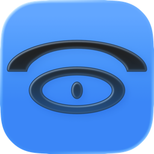

# Overwatcher

A desktop app that shows your latest **Vercel** and **Railway** deployments in one feed, each with the commit, branch and pull request behind it.

- One chronological feed across every Vercel team and Railway workspace your tokens can see
- Commit message, branch, SHA, author and PR (number, title, open/merged state) on every deployment
- Filter by status (in progress / failed), platform, environment (production / preview) and project, or search across commits, branches and PRs
- "Latest only" view: the newest deployment per project, service and environment
- Refreshes every 60s, every 10s while something is building, and sends a system notification when a deployment finishes or fails

## Connecting accounts

Open **Accounts** in the bottom-left corner and paste a token for each platform. Tokens are verified, then stored in the app's data folder encrypted with the OS keychain (Electron `safeStorage`). They're only sent to the provider they belong to.

| Platform | Token | Notes |
| --- | --- | --- |
| Vercel | [vercel.com/account/settings/tokens](https://vercel.com/account/settings/tokens) | Deployments from your personal scope and every team the token can access. |
| Railway | [railway.com/account/tokens](https://railway.com/account/tokens) | Use an **account token** (no workspace selected) to see all workspaces, or a workspace token for one. Project tokens aren't supported. |
| GitHub (optional) | [Fine-grained token](https://github.com/settings/personal-access-tokens/new) with read access to *Pull requests* and *Contents*, or **Use GitHub CLI** to reuse `gh auth token` | Finds the PR behind each commit and fills in PR titles and state. Without it, PRs only show for Vercel preview deployments and Railway PR environments. |

## Development

```sh
bun install
bun run dev        # run the app with hot reload
bun run demo       # run with fixture data, no tokens needed
bun run typecheck
bun run dist       # build a macOS .dmg / .zip into dist/
```

Built with Electron, React and TypeScript via electron-vite. All API calls happen in the main process (`src/main/providers/`); the renderer talks to it over a small IPC bridge (`src/preload/`).
