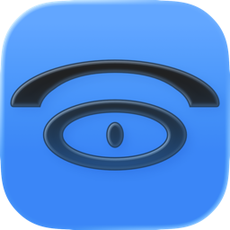

# Overwatcher

A desktop app that shows your latest **Vercel** and **Railway** deployments in one feed, each with the commit, branch and pull request behind it.

- One chronological feed across every Vercel team and Railway workspace your tokens can see
- Commit message, branch, SHA, author and PR (number, title, open/merged state) on every deployment
- Filter by status (in progress / failed), platform, environment (production / preview) and project, or search across commits, branches and PRs
- "Latest only" view: the newest deployment per project, service and environment
- Refreshes every 60s, every 10s while something is building, and sends a system notification when a deployment finishes or fails

## Connecting accounts

Open **Accounts** in the bottom-left corner and paste a token for each platform. Tokens are verified, then stored in the app's data folder encrypted with the OS keychain (Electron `safeStorage`). They're only sent to the provider they belong to.

| Platform | Token | Notes |
| --- | --- | --- |
| Vercel | [vercel.com/account/settings/tokens](https://vercel.com/account/settings/tokens) | Deployments from your personal scope and every team the token can access. |
| Railway | [railway.com/account/tokens](https://railway.com/account/tokens) | Use an **account token** (no workspace selected) to see all workspaces, or a workspace token for one. Project tokens aren't supported. |
| GitHub (optional) | [Fine-grained token](https://github.com/settings/personal-access-tokens/new) with read access to *Pull requests* and *Contents*, or **Use GitHub CLI** to reuse `gh auth token` | Finds the PR behind each commit and fills in PR titles and state. Without it, PRs only show for Vercel preview deployments and Railway PR environments. |

## Development

```sh
bun install
bun run dev        # Electron + Vite dev server with hot reload
bun run demo       # same, with fixture data (no tokens needed)
bun run check      # svelte-check + type-check the Electron main process
bun run build      # production build into out/
bun run start      # run the production build
bun run dist       # package a macOS .dmg / .zip into dist/
```

### How it fits together

Overwatcher is a SvelteKit 3 app ([async Svelte](https://svelte.dev/docs/svelte/await-expressions), [remote functions](https://svelte.dev/docs/kit/remote-functions), [shadcn-svelte](https://shadcn-svelte.com)) running inside Electron:

- **`electron/main.ts`** starts the SvelteKit server *inside the Electron main process* on `127.0.0.1`: Vite's dev server in development, the `adapter-node` handler in production. The window then loads it. The server reaches Electron only through a small host object on `globalThis` (keychain encryption, data directory), see `src/lib/server/host.ts`.
- **Remote functions** in `src/lib/*.remote.ts` are the API. `getDeployments` is a `query.live` that polls Vercel and Railway on the server (every 10s while something is building, otherwise every 60s) and streams results to the window. Account management uses `form`s with server-side validation.
- **Provider integrations** live in `src/lib/server/providers/`.
- **Security:** the local server only accepts requests that carry a random per-launch session cookie, which Electron sets for its own window (`src/hooks.server.ts`). Tokens never reach the renderer.
